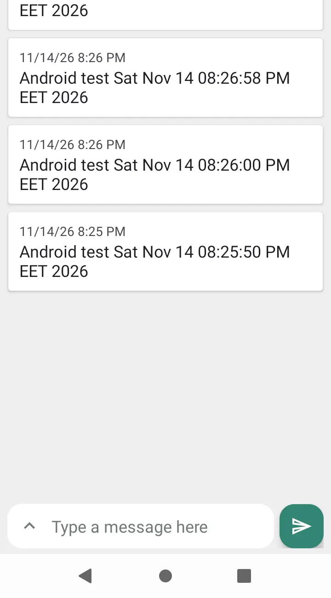

<!-- EDITORIAL DRAFT — NOT APPROVED FOR PUBLICATION. -->

The workspace now has a working ntfy notification service on its trusted development LAN.
[Superproject PR #9](https://github.com/Heretical-Solutions/Heretical-Development/pull/9)
merged the deployment, its operational tooling, and shared backup helpers into `develop`.
This is development infrastructure, not a product release or a notification integration for
any Heretical application.

## What is in place

The deployment uses the upstream ntfy 2.38.0 container, selected by an exact version and
immutable image digest. A single Docker Compose service keeps its account database and a
12-hour message cache outside Git. The container runs without root privileges, has a
read-only root filesystem, drops capabilities except for binding its HTTP listener, and
has bounded logs and explicit resource limits.

Network access is deliberately narrower than a normal hosted ntfy installation. The service
binds to one configured private LAN address and uses direct HTTP, with no public DNS,
Internet forwarding, reverse proxy, or TLS endpoint. Host firewall rules allow that port
only through the selected trusted interface and approved local source prefixes. A dedicated
firewall chain is installed before service startup and removed after shutdown; other Docker
and host rules are left alone. This design is suitable only for the controlled LAN and does
not provide transport encryption or off-LAN access.

Authentication still matters on that LAN. Anonymous access is denied, and separate publisher
and consumer identities have scoped permissions. Each device or producer receives its own
labeled, expiring token rather than sharing an administrator credential. The operator guide
covers topic naming, account grants, token rotation, Android enrollment, and desktop
subscriptions without recording live credentials in the repository.

## Verification so far

The implementation passed 155 static and mocked lifecycle checks, 43 isolated behavioral
smoke checks, and 55 synthetic backup, restore, upgrade, and rollback checks. These cover
configuration rendering, address restrictions, firewall ordering and rollback, positive and
negative ACL cases, HTTP and WebSocket streaming, persistence, and recovery safeguards.

The operator then deployed the pinned container and confirmed its health, actual LAN
filtering, scoped account behavior, Android access, and manual HTTP streaming. A real cold
backup completed successfully, its SHA-256 sidecar verified, and the service returned to a
healthy state. Those observations are recorded as a single-host deployment result, not as
proof of high availability or guaranteed delivery.

Android accepts the server when its complete `http://` URL is supplied. Plain-HTTP delivery
can still be limited to opening or refreshing the application, so the current setup does not
promise instant background push on mobile devices.

The supplied Android capture shows the test messages arriving in the application. It is a
client-delivery observation, not a claim about delivery when the server or LAN is unavailable.

## Backups and remaining work

The new shared backup registry records non-secret, machine-local paths and gives each
product its own archive and disk-export namespace. ntfy owns safe archive creation; shared
helpers only discover, copy, and verify completed archives and checksum sidecars. A disk
export must be on an explicitly mounted, separate filesystem, preventing a second directory
on the same host disk from being mistaken for off-host protection.

The first production archive has not yet been restored into an isolated staging container
or copied to an external disk. Recurring backup scheduling, retention, and LAN health
monitoring are also still operator tasks. Those are the next acceptance steps before treating
the service as having a tested recovery and retention routine.

No Kan, Woodpecker, or product-specific notification client was added. Notifications remain
non-authoritative signals; repositories, reviews, CI records, and human approvals remain the
source of engineering decisions.
