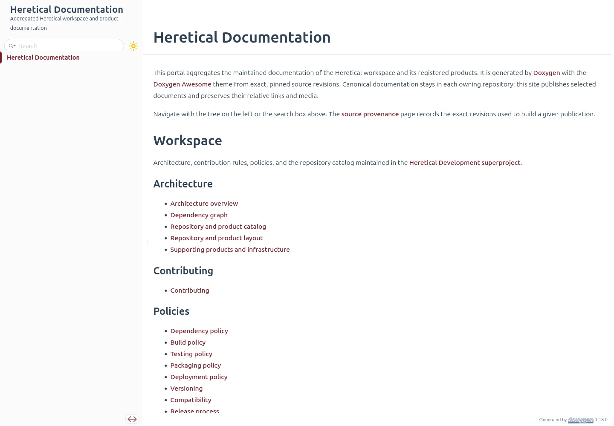
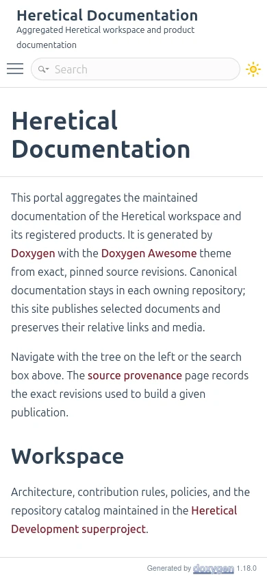

The [Heretical Documentation portal](https://heretical-solutions.github.io/Heretical-Documentation/)
is now live. It brings selected workspace and product documentation together without moving
that material out of its owning repositories. This is deployed development infrastructure,
not a product release: no engine, framework, editor, or library release is implied.

## What was built

The portal has its own source repository,
[`Heretical-Solutions/Heretical-Documentation`](https://github.com/Heretical-Solutions/Heretical-Documentation),
and builds with Doxygen 1.18.0 and Doxygen Awesome CSS 2.5.0. Both the generator release and
theme revision are pinned and verified. Doxygen is restored for the build rather than
installed globally or committed as a binary; the theme is restored from a locked Git commit.

Authoritative `eng/` commands cover restore, build, local preview, and validation. The build
aggregates explicitly selected Markdown documents into ignored intermediates, preserves
relative links and media, and records source provenance. Canonical documentation stays in
its original repository. The current publication includes workspace architecture, policies,
repository records, and the blog's product guides. It does not invent API sections for
products that publish no library API.

## Source and integration

[Superproject PR #7](https://github.com/Heretical-Solutions/Heretical-Development/pull/7)
registered the portal as an independent submodule. The final publication used these exact
source revisions:

| Input | Revision |
|---|---|
| Superproject `develop` | `5fb634ba67d674994e734be031191ac6f7824be5` |
| Portal `master` | `e02da8b27803a4c172a6928bf13976241bdf9c8e` |
| Blog `master` | `1c505359e5b4afb9323906b4b4589b00e676f57f` |

The generated [source provenance page](https://heretical-solutions.github.io/Heretical-Documentation/md_provenance.html)
records the inputs for the published site. Source aggregation, portal registration, and
website deployment remain separate operations with separate review gates.

## Validation and publication

The portal passed local validation, a clean canonical recursive checkout, and its GitHub
Actions build. Checks covered source and tool pins, internal links and fragments, document
coverage, navigation assets, payload hygiene, and the project Pages base path. A separate
C# extraction fixture passed without Unity, `.asmdef` resolution, generated project files,
compilation, or stubs. That fixture demonstrates source extraction only; it does not prove
Unity compatibility, compilation, or runtime behavior.

[Final workflow run #3](https://github.com/Heretical-Solutions/Heretical-Documentation/actions/runs/43544389084)
restored the selected inputs, validated the site, uploaded the Pages artifact, and deployed
it successfully. The live catalog, blog guides, search resources, and required license texts
were checked, and desktop and mobile Firefox renders were inspected.

The mobile layout collapses the documentation tree behind a navigation control while
keeping search and the light/dark control available.

## Boundaries and remaining checks

The portal deploys through its own GitHub Actions workflow to GitHub project Pages. The blog
keeps its separate repository, manual editorial process, and `gh-pages` publication history.
Neither site uses a custom domain in this phase. Because the canonical superproject is
private, full CI source restore uses a narrowly scoped read-only credential; untrusted pull
requests receive no source credential and run structural checks only.

The initial supported build host is Linux x86_64. No versioned documentation, product API
reference, or release compatibility claim has been added. Interactive search, theme-toggle,
and browser-console review remain manual acceptance checks. Future product sections will
come from real registered repositories and their own canonical documentation.
