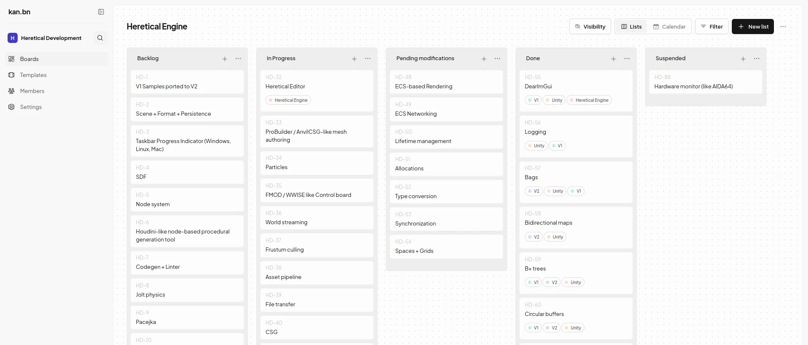

The workspace now has a working local Kan planning service, a dedicated agent
connection, and an imported Trello board. Reviewed workspace changes added the
deployment, operational tooling, and documentation. This is development
infrastructure for planning and coordination, not a product release or a public
planning service.

## A deliberately local deployment

Kan 0.7.0 and its matching migration image run as pinned containers alongside
PostgreSQL 15.20. Migrations must finish before the application starts, and the
database has no host-published port. Live state belongs to a Docker named volume
that survives container replacement and an ordinary service shutdown.

Only the browser-facing Kan listener is published, and it is bound to the local
loopback interface. There is no Caddy service, domain name, public certificate,
LAN binding, or inbound firewall change in this design. Creating the first owner
uses a temporary loopback-only registration phase; normal operation requires
unrestricted registration to remain disabled.

The service is intentionally small. Email delivery, S3 uploads, Redis, OAuth,
and hosted MCP are not configured. [Kan's public documentation](https://docs.kan.bn/)
covers the upstream application; the deployment deliberately limits its scope.
Kan coordinates planned work, while GitHub repositories, pull requests, CI
records, and human approvals remain the source of engineering truth. A card
cannot prove that code was reviewed, merged, or released.

## Dedicated agent access through MCP

The agent connection uses the pinned `@kan.bn/mcp` 0.1.0 package and a locked
dependency tree. It runs over local stdio rather than opening another network
service. A wrapper retrieves the dedicated account's API token from the user's
Secret Service when the process starts; the token is not stored in the Kilo
configuration, repository files, chat, or command-line arguments.

The agent is a separate non-admin member of the Kan workspace, not the human
owner. Workspace membership and regular-board membership are separate: the
latest live check found one accessible board, and additional boards require
explicit assignment. Kilo permits ordinary reads, asks before ordinary writes,
and denies deletion, invitations, member-role changes, and workspace
administration. Those client-side rules supplement rather than replace Kan's
own permissions.

The MCP handshake registered 46 tools. Authenticated workspace, member-role,
workspace-detail, and board-list reads passed, as did an unknown-workspace
negative check. This does not mean every tool was exercised. The upstream
`list_members` operation returned 404 against this Kan version, so verification
uses `get_workspace` instead. A new verification option also fails when required
board access is absent rather than treating an empty list as success.

## Importing and checking real work

Static checks, real-image behavioral smoke tests, and a two-version backup and
recovery rehearsal passed. They covered registration gating, invitations,
board objects, persistence, archive validation, restored board/card/checklist
content, and preservation of the original database during a failed restore.

The operator then completed a Trello import successfully. The resulting Heretical
Engine board, shown below, organizes planned and completed work without turning
planning cards into engineering authority.

The importer creates new boards rather than maintaining continuous
synchronization, and repeating an import creates duplicates. In this Kan version,
comments, attachments, members,
archived items, and due dates are not imported; unnamed labels are dropped and
exact card ordering is not guaranteed. The successful import is an operator
acceptance result, not an independent field-by-field audit.

## Backups and remaining operational work

Real online PostgreSQL backups were taken before and after the import. Both
passed dump-readability, image-provenance, and checksum verification. Kan and
ntfy now have separate product directories in the shared backup hierarchy, and
the earlier ntfy archive was copied into it without changing its contents or
deleting the original.

Those archives are protected local copies on the same filesystem, not off-host
backups. They have not been restored into an isolated staging stack, and no
external-disk export, recurring schedule, retention routine, or external health
monitor is configured yet. Those steps remain necessary before relying on this
as a complete recovery and retention practice.

The live Kan version is pinned. Isolated recovery tests do not provide a live
upgrade or rollback procedure, so those operations remain blocked until a
separately reviewed executable runbook exists. The MCP dependency audit also
reports a known high-severity availability advisory with no compatible fix; a
512 MiB process heap limit is only a partial mitigation, not a claim that the
integration is vulnerability-free.

For ordinary browser-based planning, the integration is usable now. For agent
use, board membership remains deliberate and limited. The remaining work is
operational hardening: protected off-host recovery evidence, monitoring, token
maintenance, and a safe upgrade path—not another claim that a merged change is a
released product.
