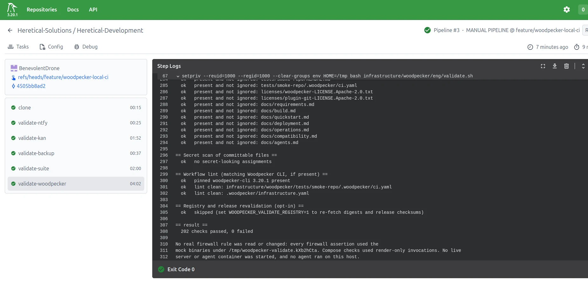

A reviewed workspace change has brought [Woodpecker CI](https://woodpecker-ci.org/)
into the development suite. The first real Development pipeline passed on a local
desktop agent, including the private workspace clone and all infrastructure
validation steps. This is working developer infrastructure, not a product release.

## A desktop-sized CI deployment

Woodpecker 3.20.1 runs in a container on the developer's machine. Its browser
interface and agent connection are loopback-only. The organization-scoped agent
runs in another container and uses the machine's Docker daemon to create sibling
build containers. No virtual machine, fixed resource reservation, public hostname,
Caddy service, reverse proxy, or public listener is required for this profile.

The agent is deliberately part of the trusted development environment. Reviewed
product workflows can compile, test, package, and back up applications; ordinary
pipeline steps do not receive the Docker socket. Initial triggering is manual or
through cron rather than automatic GitHub webhooks. The same deployment can later
serve other deliberately activated products rather than only the initial three
repositories.

## The first green pipeline

The first real Development run cloned the private workspace and completed checks
for ntfy, Kan, shared backup helpers, suite orchestration, and Woodpecker itself.
The visible Woodpecker validation step passed 202 checks. The complete run proved
private-source cloning, organization-agent scheduling, and containerized build
execution on the same machine. It did not deploy a production service, mutate the
host firewall, publish a website, or authorize a release.

Static and synthetic checks cover configuration, lifecycle rollback, backup and
recovery, and authentication boundaries. Live desktop acceptance also required
GitHub organization OAuth approval, scoped agent registration, and a harmless
manual build. Those are distinct gates: a local smoke test cannot substitute for
a real repository pipeline.

## Three deployment scales and a practical handbook

The infrastructure now distinguishes **desktop**, **homelab**, and **distributed**
profiles. Desktop is the ordinary developer setup. Homelab describes a trusted
private-network controller and workers; distributed preserves the earlier
separate-VM and trust-zone design. Unimplemented remote provisioning, public
webhook/proxy integration, and off-site recovery remain explicit stubs rather
than implied capabilities.

The accompanying Doxygen handbook collects first-clone instructions, credential
and OAuth guidance, per-tool quick starts, daily operations, backup procedures,
and troubleshooting. Its sidebar now groups guides by task, tool, and scale.
Read the [infrastructure handbook](https://heretical-solutions.github.io/Heretical-Documentation/md_infrastructure.html)
for the operator path. Public upstream details are in the
[Woodpecker documentation](https://woodpecker-ci.org/docs/intro).

## Remaining boundaries

The same-host agent is not an untrusted-code sandbox. Review workflow changes,
keep credentials scoped to their required steps, and do not automatically execute
arbitrary fork code on this agent. Public webhooks and automatic push/PR delivery
are not enabled in the initial desktop profile.

Blog and portal workflows have their own reviewed integration. Blog validation
and deployment preparation never publish automatically; portal publication uses
the separately reviewed manual Pages adapter. Higher-scale network, recovery, and
release-agent work remains separate. ntfy's original data directory is mounted,
but its required host firewall hook still needs operator verification before its
full LAN filtering can be considered restored.
